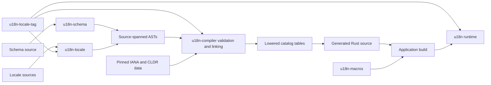

# Architecture

u18n compiles a typed message schema and locale source files into static Rust catalogs. The
source is parsed and checked before the application is built; the runtime does not parse
translation strings or load locale files. The language grammars, AST shapes, and detailed
semantic rules are specified in [Schema language and Schema AST](specification/schema-ast.md)
and [Locale language and Locale AST](specification/locale-ast.md).

## Workspace components

| Crate | Responsibility | Runtime requirements |
| --- | --- | --- |
| [`u18n-ast`](../crates/u18n-ast) | Shared source-spanned schema and locale AST types. | `no_std` + `alloc` |
| [`u18n-locale-tag`](../crates/u18n-locale-tag) | Borrowed BCP 47 syntax parsing, general packed-key helpers, and semantic locale-code encoding. | `no_std` |
| [`u18n-schema`](../crates/u18n-schema) | Parses schema source into `SchemaAst`. | `no_std` + `alloc` |
| [`u18n-locale`](../crates/u18n-locale) | Parses locale source and nested message patterns into `LocaleAst`. | `no_std` + `alloc` |
| [`u18n-compiler`](../crates/u18n-compiler) | Validates and links ASTs, resolves locale data and fallback chains, then emits Rust catalog code. | `std`; normally used while building |
| [`u18n-macros`](../crates/u18n-macros) | Proc-macro helpers used by generated message macros and `t!` dispatch. | Host-side proc macro |
| [`u18n`](../crates/u18n) | Typed catalog tables, plural evaluation, and message rendering. | `no_std` + `alloc` |
| [`u18n-cli`](../crates/u18n-cli) | Command-line front end for compilation, translator extraction, and coverage reports. | `std` |

The parsers and AST are separate so tools can parse either source format without depending on
the compiler. `u18n-ast` owns data shapes only: parsing, cross-file validation, and lowering
live in their respective crates. `u18n-locale-tag` is shared by the locale parser, compiler,
generated API, and checked runtime catalog constructor so they use the same locale syntax
profile.

## Compile-time flow

`Compiler::compile` accepts one schema and a set of locale source files. The CLI uses the same
API; build scripts can call it directly and write the generated source to Cargo's `OUT_DIR`, as
the showcase does. Compilation proceeds through these stages:

1. **Parse.** `u18n-schema` and `u18n-locale` produce typed nodes with half-open UTF-8 byte
   spans. Both parsers are independent and `no_std`; the locale parser uses the borrowed
   `u18n-locale-tag` parser to validate tag structure and builds nested pattern tokens rather
   than preserving a message as an opaque runtime string. Syntax errors can be collected at
   declaration boundaries, but a file with syntax errors has no usable AST.
2. **Load pinned locale data.** `u18n-compiler` embeds the IANA Language Subtag Registry
   snapshot and CLDR 49 plural, ordinal, alias, and supplemental data. It verifies expected
   SHA-256 digests before using the data. Locale source spelling remains the catalog
   identity. Plural-component parent lookup finds rule sets, while the separate
   main-component parent map supplies the generated runtime catalog-selection helper.
3. **Validate and link.** The schema defines unique message keys, parameter names, types, and
   argument order. The compiler checks locale keys and selector/format uses against those
   definitions, assigns each referenced parameter a schema-order slot, validates plural
   categories against CLDR, and checks locale-tag registration and casing. It verifies
   explicit fallback targets and cycles, then resolves every schema message for each catalog
   by following the authored fallback chain. Each resolved pattern stays whole and records
   its author locale; it is not spliced together from multiple files.
4. **Lower.** The compiler lowers the complete catalog for the dynamic-ID API, interning patterns
   and rule sets across keys into one shared store. It also lowers each schema key independently
   into a shard containing that key's argument count, locale-to-program choices, unique resolved
   programs, selector tables, rule sets, and UTF-8 pool. The keyed lowerer interns and pools only
   within one key. Each dynamic locale view keeps sorted bindings for messages authored there and
   its direct explicit fallback link. The shared and shard pools use the same bounded overlap
   optimization; compiler output reports both sets of statistics.
5. **Emit.** The compiler writes one shared static program store for dynamic IDs, independent
   lightweight locale handles and full `Catalog` views, and one keyed static shard per schema key.
   It also emits generated message macros, a closed `LocaleTag` enum with one variant per source
   locale, a case-insensitive string-sorted source-locale index, and a
   numerically sorted `u64` binary-search index for CLDR main parents. Each parent row stores one
   packed key: the child semantic code shifted left three bits, with the fixed private
   `ParentLocale` discriminant in the low three bits. The enum supplies the canonical parent tag
   after lookup. The `t!` dispatcher is emitted alongside them. The fingerprint hashes source inputs,
   generation options, output-format version (`1`), and all pinned locale-data digests, including
   cardinal rules and aliases used for plural resolution and supplemental data used by runtime
   locale fallback.

The semantic compiler is divided into schema linking, pattern linking, fallback resolution, CLDR
lookup, and code generation. Diagnostics preserve source spans and can include related spans in
the schema or another locale declaration. Those source locations are used during compilation and
are not emitted into runtime tables.

## Generated API and macro expansion

The compiler emits a macro and message shard for each schema key, a lightweight locale handle and
full dynamic catalog for each source locale, a closed `LocaleTag` enum, and the key-based `t!`
dispatcher. Key macros take `&Locale` and their own shard. Callers can get the handle through
`LocaleTag::as_locale()` or `catalogs::locale_<tag>::LOCALE`. Dynamic-ID callers use
`LocaleTag::as_catalog()` or `catalogs::locale_<tag>::CATALOG`. The generated enum and its lookup
behavior are described in [Locale identity](policy.md#locale-identity).

### Generated message calls

Per-message macros accept positional arguments in schema order or named fields. The proc-macro
helpers check arity and field names, then create typed runtime argument values. Named expressions
are evaluated once in written order and then placed in schema order. Rust type checking checks
the values against the generated schema signature.

### Catalog selection and dispatch

`t!` dispatches by a literal message key. In the default build configuration, calls pass a
`locale = expression` header to select the lightweight locale handle. Optional atomic mode stores
a pointer to the current `Locale` and requires a configured final fallback locale and pointer-width
atomics. `current_catalog()` remains a separate dynamic-ID conversion. See [Advanced
usage](advance.md#optional-process-wide-locale-selection) for configuration details.

### Typed formatting

Messages whose resolved patterns use a typed format operation accept a formatter argument. The
runtime's `Formatter` trait receives the selected locale's exact source tag, a typed value,
closed format options, and a `core::fmt::Write` sink. Formatting policy belongs to the
application; the runtime does not implement locale-specific number or date formatting.

## Runtime model

`u18n` is `no_std` and consumes immutable tables emitted by the compiler. Keyed rendering selects
the program from one message shard using the lightweight locale index, then walks only that
shard's tables. It has no fallback traversal or reference to the global store. Dynamic rendering
uses `Catalog`, binary-searches authored bindings, follows fallback links, and reads the shared
program store. Both paths use the same branch and formatting evaluator. Their streaming variants
write to a caller-owned sink without allocating during table lookup or rendering. `Catalog::try_new`
validates application-built dynamic catalogs; compiler-created keyed shards and dynamic stores
use trusted static constructors after compile-time validation. The checked constructor validates
each plural rule set and each plural node's category branches once. Rendering then relies on those
immutable tables, so plural selection does not repeat the rule-category check.

The linker can discard unused keyed data when the target link uses data-section garbage collection
and does not otherwise root the sections. The `scripts/check-keyed-size.sh` fixture verifies linked
release artifacts for one key, several keys, all keys, and dynamic IDs. It checks that unique
payloads from unused shards are absent and reports each artifact's read-only data section size.

Plural and ordinal selectors use separate compiled CLDR rule sets. Interned programs keep the
rule set of the locale that authored the pattern, even when a child locale resolves it through
its fallback chain. Formatters receive the selected locale's exact source tag. Exact integer
branches are checked before category rules, while `#` renders the active innermost count. Plural
selection assumes its rule-category tables were checked at catalog construction or by the compiler.
Selector nesting is bounded at 32 by the parsers, semantic validation, and runtime catalog
validation. Runtime errors cover malformed tables, invalid argument counts or types, missing
formatters, formatter failures, and output failures.

Schema values are deliberately distinct: count and rank wrappers carry plural meaning, `number`
delegates display to the caller's `Display` implementation, and decimal, money, date, time, and
instant values use typed formatting operations. Decimal plural inputs preserve visible scale for
CLDR operands. The runtime itself performs no locale-file I/O, dynamic catalog registration, or
pattern parsing.

## CLI and translator tooling

`u18n-cli` exposes three operations over the compiler API:

- `compile` emits generated Rust, optionally with pooled-string limits and atomic locale
  selection.
- `extract` writes deterministic JSON with schema documentation, parameter notes, and the quoted
  pattern selected from a requested locale's fallback chain. It records the locale that
  authored an inherited pattern.
- `coverage` reports authored, inherited, and missing schema messages per locale.

Extraction and coverage are build-time tools. They do not change the source grammars or the
generated runtime catalog format.

## Tests

Parser behavior is covered by the `u18n-schema` and `u18n-locale` integration tests. Compiler
API and diagnostics are covered in `u18n-compiler`; keyed and dynamic rendering plus catalog
validation are covered in `u18n`; the showcase compares keyed output against dynamic rendering
and includes call-site UI tests. The linked-size script checks unused-shard collection in release
artifacts.
